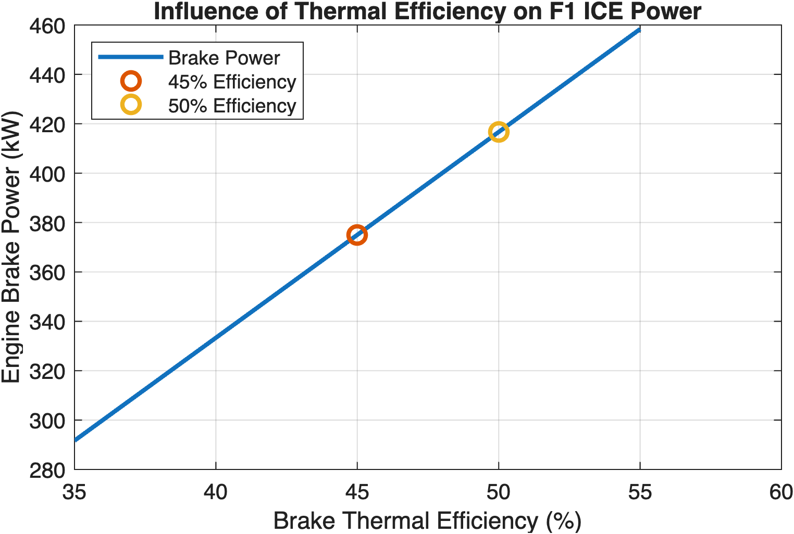
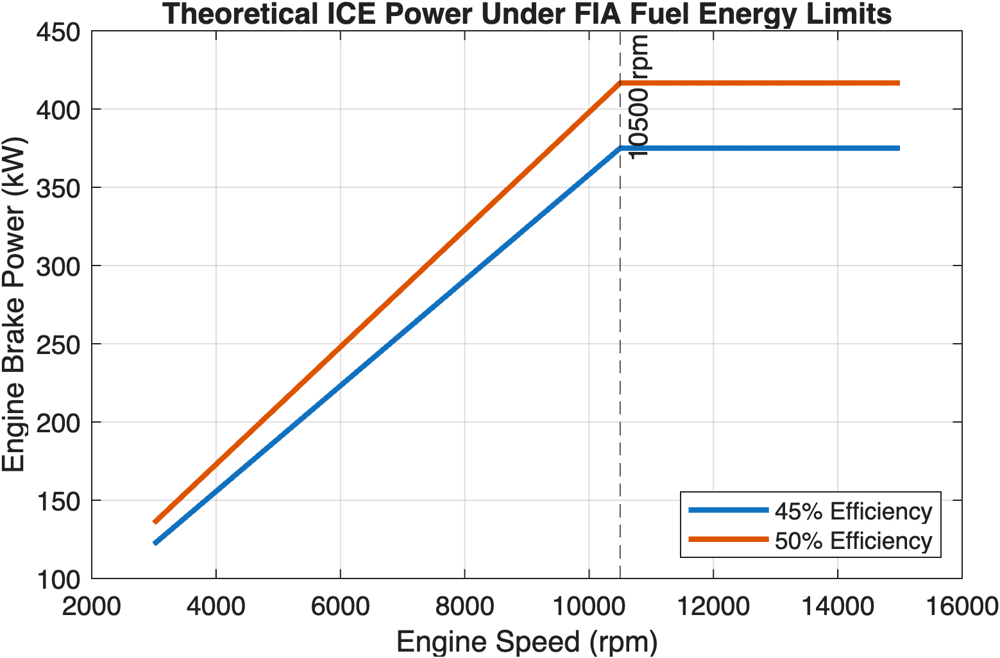
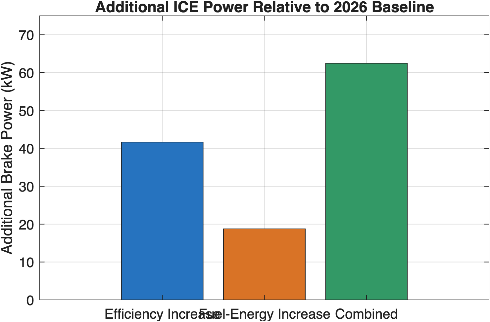

# Project 01: Formula 1 Power Unit Performance

Investigating fuel-energy restrictions, thermal efficiency and theoretical engine performance

## Overview

With the introduction of the 2026 power-unit regulations in Formula 1 and the announced increase in permitted fuel-energy flow for 2027, an interesting engineering question arises:

**What is more valuable for engine performance: increasing the available fuel energy or improving the efficiency with which that energy is converted into mechanical power?**

This project uses MATLAB to investigate how fuel-energy restrictions, brake thermal efficiency and engine speed influence theoretical power-unit performance.

## Methodology

The investigation progresses through 5 steps:

1. Fuel Energy & Thermal Efficiency: Investigating the relationship between fuel-energy input, brake thermal efficiency and engine brake power.
2. Engine Speed & Torque: Modelling theoretical power and torque curves using a speed-dependent fuel-energy-flow restriction.
3. Hybrid Powertrain: Introducing a simplified MGU-K model to investigate electrical deployment, harvesting and stored energy.
4. 2026 vs 2027 Regulations: Comparing theoretical ICE power under the assumed maximum fuel-energy limits of 3,000 MJ/h and 3,150 MJ/h.
5. Efficiency vs Regulation: Comparing the additional power obtained through improved thermal efficiency against the increase in permitted fuel-energy input.

The full execution is found in the MATLAB Live Script in this git repository. To run the model, you can download and clone this repository and run the Live Script to view the calculations and figures. 

## Key Results

Using a baseline engine operating at 45% brake thermal efficiency under the 2026 maximum fuel-energy-flow limit:

| Scenario | Additional ICE Power |
|---|---:|
| Improving thermal efficiency from 45% to 50% | **+41.7 kW** |
| Increasing permitted fuel-energy flow by 5% | **+18.8 kW** |
| Combining both improvements | **+62.5 kW** |

The five-percentage-point improvement in thermal efficiency produces over two times more additional power than the 5% permitted increase in fuel-energy input for 2027. This shows the importance of energy conversion efficiency when fuel-energy input is restricted, although achieving such an efficiency improvement presents a significant engineering challenge. 

## Results & Visualizations

### Thermal Efficiency vs. Engine Power

### Engine Power vs. RPM

### Efficiency Improvement vs. Regulatory Increase

## Limitations

This investigation uses simplified theoretical models and assumed thermal efficiencies. Conversion losses and detailed energy-management constraints. The results are just rough approximations to answer the main question of the project. The 2027 comparison applies the announced 5% increase in permitted fuel-energy flow to the assumed 2026 maximum set in the model.